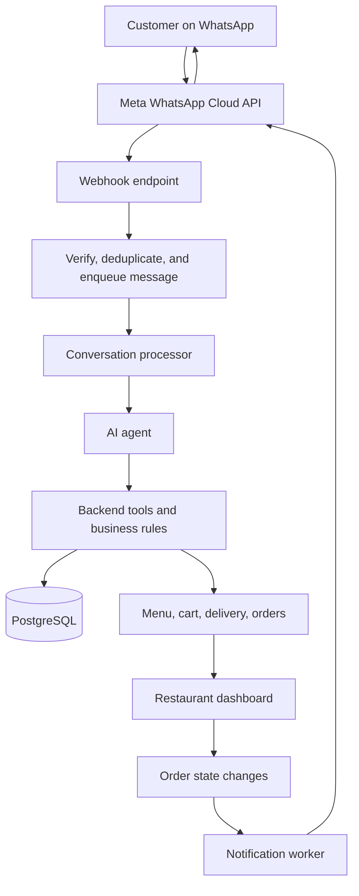
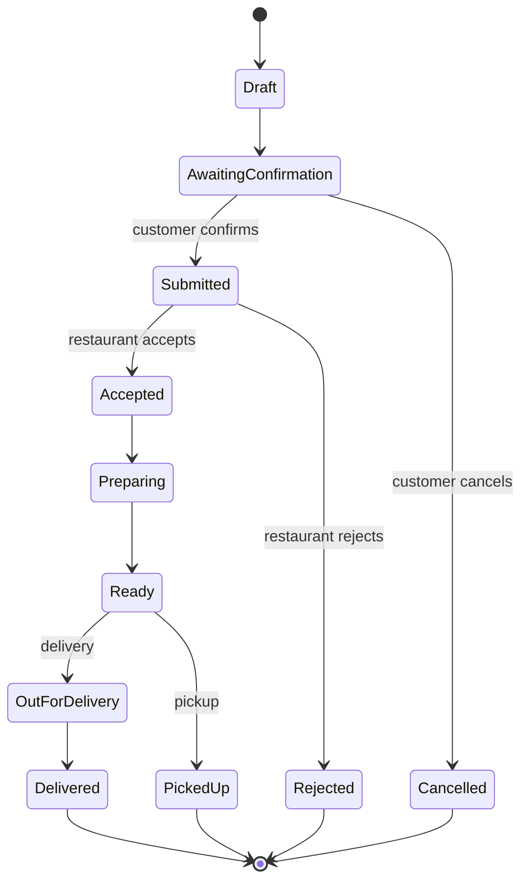

# WhatsApp AI Restaurant Ordering Assistant

**Document type:** Project overview and implementation blueprint  
**Version:** 1.0  
**Primary stack:** TypeScript, Node.js, Next.js, PostgreSQL, WhatsApp Cloud API  
**Target users:** Restaurants accepting delivery and pickup orders through WhatsApp

---

## 1. Project Overview

Build an AI-powered WhatsApp ordering assistant that lets customers order food through natural-language messages. The assistant understands requests, checks the restaurant's actual menu and availability, manages a shopping cart, confirms delivery or pickup details, and submits validated orders to a restaurant dashboard.

The system is **not just a chatbot**. It is an order-management application with an AI conversational interface. Restaurant staff still control order acceptance, food preparation, exceptions, and fulfillment.

### Primary goals

- Let customers order without installing another app or visiting a website.
- Reduce the time staff spend answering routine WhatsApp messages.
- Prevent invented prices, invalid products, duplicate orders, and unconfirmed charges.
- Give restaurants a dashboard for receiving, accepting, preparing, and completing orders.
- Design the platform so multiple restaurants can eventually use the same underlying software.

### MVP boundaries

**Include:** One restaurant, one WhatsApp number, text messages, menu lookup, cart creation and edits, delivery/pickup selection, cash on delivery or pay at pickup, explicit customer confirmation, order creation, staff dashboard, and order-status updates.

**Defer:** Online payment gateway, voice-note transcription, loyalty programs, delivery-driver tracking, POS integrations, advanced analytics, marketing campaigns, and multi-tenant billing.

---

## 2. End-to-End Architecture



### Component responsibilities

| Component | Responsibility |
|---|---|
| WhatsApp Cloud API | Receives and sends customer messages through Meta's platform. |
| Webhook server | Verifies inbound events, acknowledges requests, and queues work. |
| Queue/worker | Processes messages reliably and handles retries. |
| AI agent | Understands natural language and chooses authorized tools. |
| Application services | Enforce menu, pricing, cart, order, payment, and delivery rules. |
| PostgreSQL | Stores restaurant data, customers, conversations, carts, orders, and events. |
| Restaurant dashboard | Lets staff manage menus and fulfill orders. |
| Notification service | Sends deterministic order and payment status messages. |

**Core separation:** The AI handles language. Trusted backend code controls prices, availability, order writes, and payment state.

---

## 3. Customer Ordering Flow

### Example conversation

**Customer:** “Hi, I want two cheeseburgers and one Coke.”

**Assistant:**

> Here's your order:
>
> - 2 × Cheeseburger — COP 40,000
> - 1 × Coke — COP 5,000
>
> Subtotal: **COP 45,000**. Would you like delivery or pickup?

**Customer:** “Delivery to Calle 85, Bogotá. One burger without onions.”

**Assistant:**

> I've added that instruction. Your subtotal is COP 45,000 and the delivery fee is COP 6,000, for a **total of COP 51,000**. Would you like to pay online or cash on delivery?

**Customer:** “Cash.”

**Assistant:**

> Please confirm: 2 cheeseburgers (one without onions), 1 Coke, delivery to your provided address, total COP 51,000, cash on delivery. **Should I place the order?**

**Customer:** “Yes, confirm.”

**Assistant:**

> Order **#1042 submitted**. We're sending it to the restaurant for acceptance. You'll receive an update when it's accepted.

**Restaurant employee:** Accepts the order in the dashboard.

**Automated notification:** “Your order #1042 has been accepted and is being prepared.”

All prices, products, stock, fees, and order IDs above are **illustrative**; in production they must come from verified application data.

### Flow as application steps

1. Receive an inbound WhatsApp message.
2. Authenticate its source, deduplicate it, and identify the correct restaurant.
3. Load the customer's conversation state and active cart.
4. Pass relevant context and authorized tools to the AI agent.
5. The agent looks up real menu items and requests cart changes through tools.
6. Backend code checks product options, availability, pricing, and delivery rules.
7. Ask follow-up questions for missing information.
8. Present a complete order summary with final total and payment method.
9. Require the customer's explicit confirmation.
10. Create the order with an idempotent operation, and send it to the restaurant dashboard.
11. Restaurant staff accept, reject, and update the order.
12. Send appropriate WhatsApp status notifications as order states change.

---

## 4. AI Agent Tools

The agent should access **small, permissioned business operations**, not the database directly.

| Tool | What it does |
|---|---|
| `getMenu` | Lists active products, prices, variants, and descriptions. |
| `getMenuItem` | Retrieves a specific item and its allowed modifiers. |
| `checkAvailability` | Checks whether items can currently be ordered. |
| `addToCart` | Adds validated items and optional modifications. |
| `updateCart` | Changes quantities, modifiers, or removes items. |
| `getCart` | Reads the current cart and server-calculated totals. |
| `checkDeliveryZone` | Checks whether the restaurant serves an address/area. |
| `calculateTotal` | Calculates subtotal, fees, taxes, and discounts. |
| `submitConfirmedOrder` | Creates an order only after explicit confirmation. |
| `getOrderStatus` | Reads the state of an existing order. |
| `requestHuman` | Flags or transfers a conversation to a staff member. |

### Non-negotiable rules

- The agent **must not invent** menu items, prices, delivery charges, discounts, or availability.
- The backend must validate all tool inputs independently of the model.
- Never create an order from vague intent; require a clear final confirmation.
- Final totals must be recalculated on the server immediately before order submission.
- Use an idempotency key so retries or repeated webhook events cannot submit the same order twice.
- Treat instructions inside customer messages as untrusted input; they cannot override business logic or tool permissions.
- A tool for initiating a payment must **never** be able to mark that payment successful.
- Escalate ambiguous orders, unavailable items, complaints, and exceptions to staff when necessary.

### Do you need RAG?

**No, not for the initial ordering experience.** Menus, modifiers, availability, delivery fees, carts, and orders should live in structured database tables and be accessed with application tools. RAG can be added later for unstructured information such as restaurant handbooks, detailed FAQs, or policy documents. RAG should not be the source of truth for prices or stock.

---

## 5. Message Handling and Reliability

### Inbound message pipeline

```text
WhatsApp message
   ↓
POST /webhooks/whatsapp
   ↓
Validate Meta webhook signature
   ↓
Record message ID and deduplicate
   ↓
Enqueue processing job
   ↓
Return successful HTTP response quickly
   ↓
Worker loads restaurant, customer, cart, and context
   ↓
AI agent calls backend tools
   ↓
Persist cart/conversation changes
   ↓
Send WhatsApp reply
```

### Reliability practices

- **Webhook verification:** Validate callback setup and verify signed inbound payloads.
- **Idempotency:** Persist external message IDs and reject duplicate processing.
- **Per-conversation ordering:** Avoid racing changes when a customer sends multiple messages quickly.
- **Queues and retries:** Use a queue for processing and outbound notifications; implement bounded retries with a dead-letter or failure-review path.
- **Audit trail:** Record order state transitions and critical tool actions.
- **Human fallback:** Preserve enough context for staff to resolve failed or ambiguous interactions.
- **Observability:** Track delivery failures, tool errors, order failures, handoffs, and end-to-end latency.

### Conversation state

Track the current state in your own database rather than relying only on an LLM's context window. Example fields:

```text
conversation_id
restaurant_id
customer_id
status              (active | waiting_for_staff | closed)
current_cart_id
current_step        (browsing | cart | fulfillment | payment | confirmation)
last_customer_message_at
last_whatsapp_message_id
```

Keep conversation summaries if needed, but use the database cart and order records as the authoritative state.

---

## 6. Restaurant Dashboard

The restaurant should have a web interface for:

- **Incoming orders:** Accept or reject a new order and review its items and instructions.
- **Order fulfillment:** Mark an accepted order as preparing, ready, out for delivery, delivered, or picked up as appropriate.
- **Menu management:** Change prices, products, modifiers, and availability.
- **Operations:** Configure hours, closures, pickup options, delivery zones, and fees.
- **Conversations:** Review chats and intervene when the agent transfers a customer.
- **Basic reporting:** View total orders, order values, fulfillment status, and cancellations.

### Example order card

```text
ORDER #1042                      NEW
------------------------------------
2 × Cheeseburgers
1 × Coke
Note: One burger without onions

Fulfillment: Delivery
Payment: Cash on delivery
Total: COP 51,000

[Accept]  [Reject]
```

Changing an order state should create a database event and enqueue a corresponding customer notification. Routine operational updates can use deterministic templates; an AI response is not needed for every event.

---

## 7. Order State Machine



Define valid transitions in backend code, not in the agent's instructions. Payment status and fulfillment status should be **separate fields** because a paid order is not necessarily accepted or delivered.

---

## 8. Payments

### MVP: offline methods

1. **Cash on delivery:** Order is submitted and staff/driver collect payment upon delivery.
2. **Pay at pickup:** Staff collect payment when the customer arrives.

### Later: online payments

For a Colombian restaurant, a provider such as **Wompi** can generate a checkout link.

```text
Customer confirms cart
    ↓
Backend creates order/payment intent
    ↓
Backend creates payment checkout/link
    ↓
Customer pays on payment provider's page
    ↓
Provider sends signed payment webhook
    ↓
Backend verifies provider event + transaction status
    ↓
Payment state updates to paid/failed/pending
    ↓
Restaurant processes order according to business policy
```

### Payment security

- Never accept “I paid” in chat as proof of payment.
- Verify payment notifications, transaction IDs, amounts, currencies, and order associations on the backend.
- Handle duplicate and out-of-order webhook events.
- Don't store card details in your own application.
- Define refund, rejection, and expired-checkout behavior before launching online payments.

---

## 9. Database Design

A practical initial relational schema:

| Table | Purpose |
|---|---|
| `restaurants` | Restaurant identity, settings, timezone, business status. |
| `restaurant_channels` | WhatsApp business account/phone number mapping. |
| `staff_users` | Dashboard access and restaurant roles. |
| `menu_categories` | Categories such as burgers or beverages. |
| `menu_items` | Products, prices, active status. |
| `menu_modifiers` | Allowed extras, removals, sizes, and price adjustments. |
| `customers` | Restaurant-scoped customer profile/contact information. |
| `conversations` | WhatsApp conversations and handoff state. |
| `messages` | Inbound/outbound message metadata and deduplication IDs. |
| `carts` | Draft shopping carts. |
| `cart_items` | Products, quantities, selected modifiers. |
| `orders` | Immutable order snapshot, total, status, fulfillment method. |
| `order_items` | Purchased items with captured names, prices, quantities, modifiers. |
| `order_events` | Audit history of state changes. |
| `payments` | Provider references, method, status, and amounts. |
| `delivery_zones` | Supported delivery regions and fees. |

### Data-design notes

- Store prices as integer minor units (e.g., COP integer amounts where appropriate), not floating-point numbers.
- Capture price and item details in `order_items` so historic orders don't change when the menu changes.
- Add `restaurant_id` to restaurant-owned records, with proper access controls.
- Use transactions to create final orders and reserve or verify available inventory where applicable.
- Retain only necessary customer and chat data, with suitable access, retention, and deletion controls.

---

## 10. Proposed Technology Stack

| Layer | Preferred option |
|---|---|
| WhatsApp | Meta WhatsApp Cloud API |
| Frontend dashboard | Next.js + Tailwind CSS |
| Client data fetching | TanStack Query |
| Backend | Node.js + TypeScript + Express or Fastify |
| AI agent | Vercel AI SDK or Eve, integrated with backend tools |
| Database | PostgreSQL + Prisma |
| Validation | Zod |
| Queue/workers | BullMQ + Redis |
| Payments (later) | Wompi or another regional gateway |
| Authentication | Auth.js or a suitable identity provider |
| Deployment | Vercel for frontend; hosted Node.js service/worker for backend |

### Suggested repository layout

```text
whatsapp-restaurant-platform/
├── apps/
│   ├── dashboard/              # Next.js restaurant interface
│   └── api/                    # HTTP API and WhatsApp webhooks
├── workers/
│   ├── message-processor/      # Queue consumer and agent execution
│   └── notifications/         # Outbound WhatsApp messages
├── packages/
│   ├── db/                     # Prisma schema and database access
│   ├── contracts/              # Shared Zod schemas and TS types
│   ├── domain/                 # Cart, order, payment business rules
│   ├── whatsapp/               # Meta API adapter
│   └── agent/                  # Agent instructions and approved tools
└── docs/
    └── whatsapp_restaurant_ai_assistant.md
```

You can start with a simpler monorepo and split workers into separate deployable services when necessary.

---

## 11. WhatsApp Integration Requirements

1. Create and configure a Meta developer app.
2. Set up WhatsApp Business Platform / Cloud API access.
3. Configure a business phone number or an appropriate test number.
4. Register an HTTPS webhook and verify subscriptions.
5. Store secrets securely and implement token rotation/management.
6. Send replies through the official API and process message status callbacks.
7. Implement permitted message types, templates, and customer-service-window behavior.
8. Verify phone-number onboarding, display-name approval, business verification, and coexistence requirements when onboarding each restaurant.

**Operational constraint:** WhatsApp's 24-hour customer-service window and approved-template rules affect outbound notifications after the customer-service window closes. Pricing and allowed message categories can change; check Meta's current official documentation before pricing your SaaS or launching campaigns.

Official entry point: <https://developers.facebook.com/docs/whatsapp/cloud-api/>

---

## 12. Security and Production Requirements

- Verify WhatsApp webhook signatures and reject unauthorized requests.
- Protect dashboard sessions with authentication and role-based authorization.
- Scope each database query to the correct restaurant and prevent cross-tenant access.
- Treat customer messages and tool output as untrusted input.
- Validate every tool's parameters and enforce allowed order operations.
- Rate-limit potentially abusive requests and guard against unexpected API/model costs.
- Encrypt transport, securely store API tokens, and restrict database privileges.
- Record consent and handle personal data under applicable privacy laws.
- Prevent duplicate charges, orders, and outbound notifications during retries.
- Create safe paths for restaurant closure, out-of-stock items, expired carts, unavailable delivery, and human intervention.

---

## 13. Build Roadmap

### Stage 1 — End-to-end MVP

**Goal:** One customer can submit one correct order, and the restaurant can receive and accept it.

- Implement webhook receive/verification and outbound WhatsApp messages.
- Build menu, modifier, cart, customer, and order database models.
- Build the agent's approved tool layer.
- Implement delivery/pickup and final order confirmation.
- Create an order dashboard with basic order actions.
- Send order receipt and acceptance/status notifications.
- Run end-to-end tests using a test WhatsApp number.

**Acceptance criteria:** A customer can order two menu items with one modification; the server shows the correct price; the customer confirms; exactly one order appears in the restaurant dashboard; an employee accepts it; the customer receives the update.

### Stage 2 — Reliable production operations

- Add Redis/BullMQ workers, retries, dead-letter handling, and observability.
- Add payment-link integration and provider webhook verification.
- Add human handoff, out-of-stock recovery, cancellation and refund policies.
- Add voice notes and interactive WhatsApp buttons/Flows if valuable.
- Add automated tests for concurrency, idempotency, pricing, security, and failure recovery.

**Acceptance criteria:** Duplicate messages do not cause duplicate orders; payment confirmation cannot be spoofed; operator actions are auditable; temporary failures recover safely.

### Stage 3 — Multi-restaurant SaaS

- Add multi-tenant onboarding and restaurant-specific WhatsApp connections.
- Isolate menus, customers, orders, staff, and configuration by restaurant.
- Introduce subscription billing, usage metering, restaurant admin settings, and support tools.
- Add reporting, POS integrations, promotions, and advanced integrations as customers request them.

**Acceptance criteria:** A new restaurant can be onboarded mainly through configuration without copying application code or exposing another restaurant's data.

---

## 14. MVP Test Scenarios

| Scenario | Expected result |
|---|---|
| “Two burgers, one without onions” | Correct quantity and one-item modifier. |
| Unknown product | Agent asks or offers real alternatives, never invents an item. |
| Product unavailable | Agent proposes alternatives or removes the item with confirmation. |
| Unsupported address | Delivery is declined or pickup is offered. |
| Restaurant closed | Application follows configured off-hours policy. |
| Customer changes quantity | Cart and final total are recalculated. |
| Customer says “maybe” | No order is created without explicit confirmation. |
| Duplicate WhatsApp webhook | Message/order action processes at most once. |
| Two messages arrive rapidly | No lost cart updates or inconsistent totals. |
| Staff rejects an order | Customer is informed; payment/refund workflow follows policy. |
| Payment provider event repeats | No duplicate paid transition or side effects. |
| Customer asks for an employee | Human handoff is initiated with conversation context. |

---

## 15. Product Strategy

Start with **one reusable ordering engine**, not a new codebase or custom agent for every restaurant.

```text
Restaurant A ─┐
Restaurant B ─┼── Shared SaaS platform
Restaurant C ─┘          ├── Agent + approved tools
                         ├── Restaurant-specific menus/settings
                         ├── Orders and payments
                         ├── WhatsApp integration
                         └── Restaurant dashboards
```

Each restaurant has its own WhatsApp connection, data, menu, hours, delivery rules, staff, and branding; the underlying software is shared.

### First milestone

> A customer messages a restaurant on WhatsApp, selects available items, confirms a server-validated total, and the restaurant receives exactly one actionable order in its dashboard.

**Prioritize correctness and reliability over AI complexity.** Every added feature should preserve accurate prices, explicit customer confirmation, and dependable fulfillment.
